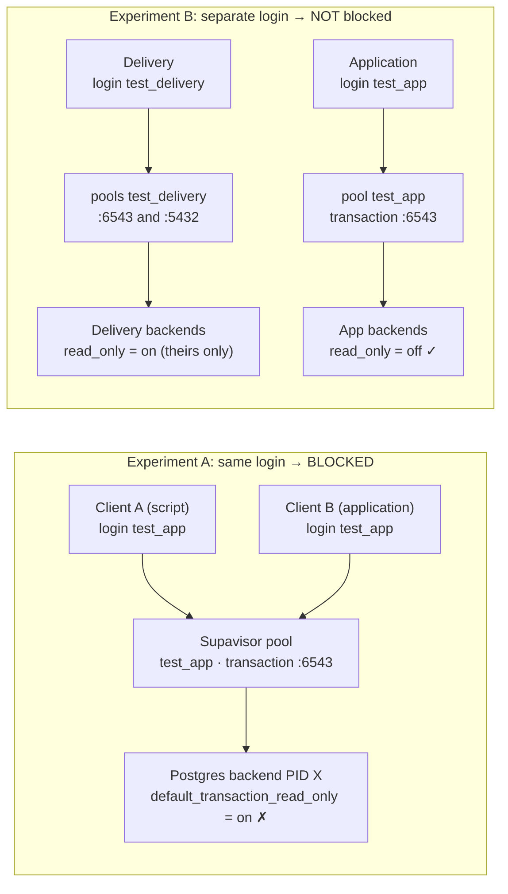

# Pool isolation lab: does a read-only setting leak through Supavisor?

> This is the **detailed lab**. For the simple sign-up demo, see the main [README](../README.md).
> The lab pages live at http://127.0.0.1:3000/lab and need the extra `.env` keys described below.


A small, disposable experiment that answers one question:

> If the **application** connects as `test_app` through a Supavisor **transaction pool**, and
> **Delivery** connects as a **separate login** `test_delivery`, can a session-level
> `SET default_transaction_read_only = on` done by Delivery break the application's writes?

It reproduces the original incident (shared login → app writes fail with `25006`) and then shows
the same action from a separate login does **not** affect the app, with backend PIDs as evidence.
Everything runs against **real hosted Supavisor** on one disposable Supabase project.

**Result of the run on 2026-11-06 (details in [Results](#results-from-the-recorded-run)):**

| Experiment | Expected | Actual |
|---|---|---|
| A · Same login, same transaction pool | BLOCKED | **BLOCKED**: 20/20 app writes landed on the poisoned backend and failed with 25006 |
| B · Delivery on its own login (tx pool + session pool) | NOT BLOCKED | **NOT BLOCKED**: 30/30 app writes OK, zero shared backend PIDs |
| C · Same login, but `BEGIN READ ONLY` / `SET LOCAL` | NOT BLOCKED | **NOT BLOCKED**: app reused the script's backend and still wrote fine |
| Test 1 · Baseline | PASS | **PASS** |
| Test 4 · Permissions (17 checks + membership check) | PASS | **PASS** |
| **Realistic Run 1** · services + migration on one shared login | BLOCKED | **BLOCKED** in 3 of 4 attempts (12–35% of writes failed with 25006); 1 attempt INCONCLUSIVE (0 failures) |
| **Realistic Run 2** · migration on its own login (`:6543` and `:5432`) | NOT BLOCKED | **NOT BLOCKED** in 5 of 5 runs: 2,068 of 2,068 writes saved, zero shared backends |

---

## 0. Realistic test: your setup, in miniature

This is the closest model of what happened to you. It's in [lib/realistic.mjs](../lib/realistic.mjs).

**Tables** (schema `realistic_test`, fake data): `learners` (200 seeded), `assessments` (20),
`submissions` (FKs to both), `hub_events`. Every row records, **filled in by the database**,
which login (`login_role`) and which Postgres process (`backend_pid`) wrote it, plus `service` and `run_id`.

**Logins:**

| Login | Plays the part of |
|---|---|
| `test_shared` | your single connection string, used by app, hub and assessment. It is a member of the table owner (like everyone using `postgres`). |
| `test_migrator` | a separate login for migrations. It owns the tables. |

**What happens in each run (about 45 s):**
1. Six service connections (app ×2, hub ×2, assessment ×2) log in as `test_shared` on the
   transaction pooler `:6543` and write continuously for 30 s:
   - app inserts learners;
   - assessment inserts a submission and updates the assessment's attempt counter;
   - hub inserts events.
2. At 6 s a **migration** starts. It runs `ALTER TABLE learners ADD COLUMN nickname`,
   `CREATE INDEX`, and a backfill `UPDATE`.
3. Then the migration runs the risky "verification" step from the incident. Three checkers each do
   `SET default_transaction_read_only = on` (session level), run a check query, commit, and disconnect.
4. After 30 s the services stop. The read-only backends are recycled, and rows are **counted from the
   tables**.

- **Run 1:** the migration logs in as `test_shared`, the same login and pool as the services.
- **Run 2:** the migration logs in as `test_migrator`, through the same transaction pooler `:6543`
  (only the login differs) and through the session pooler `:5432`.

```bash
npm run lab:realistic
```

This sets up the tables, then runs Run 1 (up to 3 attempts, all reported) and Run 2 on both ports.
It writes `results/realistic-report.md`. The page (`npm run demo`) has buttons for each run with
a timeline of every write: green = saved, red = rejected.

**Every realistic run on 2026-11-06** (project `sgjsocdtrhztgdrllbcj`, real hosted Supavisor).
"Saved" is counted from the tables after each run.

| Run | Migration login / port | Service writes | Saved in tables | Rejected 25006 | Backends shared with migration | Verdict |
|---|---|---|---|---|---|---|
| Run 1 #1 | `test_shared` / :6543 | 333 | 333 | 0 | yes, but none after its read-only step | INCONCLUSIVE |
| Run 1 #2 | `test_shared` / :6543 | 341 | 299 | **42** (12%) | yes | **BLOCKED** |
| Run 1 #3 (page) | `test_shared` / :6543 | 402 | 262 | **140** (35%) | yes | **BLOCKED** |
| Run 1 #4 (report) | `test_shared` / :6543 | 441 | 387 | **54** (12%) | yes | **BLOCKED** |
| Run 2 | `test_migrator` / :6543 | 400 | 400 | 0 | **none** | NOT BLOCKED |
| Run 2 | `test_migrator` / :5432 | 402 | 402 | 0 | **none** | NOT BLOCKED |
| Run 2 (page) | `test_migrator` / :6543 | 415 | 415 | 0 | **none** | NOT BLOCKED |
| Run 2 (report) | `test_migrator` / :6543 | 435 | 435 | 0 | **none** | NOT BLOCKED |
| Run 2 (report) | `test_migrator` / :5432 | 416 | 416 | 0 | **none** | NOT BLOCKED |

In every Run 1 failure, the service had been writing fine on that same backend PID **before** the
migration's read-only step, and failed on it **after**. In every Run 2, the migration's schema change
was applied and its own backends were confirmed read-only (its own checks ran with `default_ro = on`).
The server listed those backends under `test_migrator` until the end of the run, but no service write
ever landed on one.

See it in the Supabase SQL Editor:

```sql
select run_id, service, count(*) as rows_saved, string_agg(distinct login_role, ',') as login
from (
  select run_id, service, login_role from realistic_test.learners where run_id <> 'seed'
  union all select run_id, service, login_role from realistic_test.submissions
  union all select run_id, service, login_role from realistic_test.hub_events
) t
group by 1, 2 order by 1, 2;
```

**Why Run 1 doesn't fail the same way every time:** it depends on which pooled backend each service
transaction borrows after the migration's read-only step. In one attempt the pooler happened not to
hand any of the migration's read-only backends to a service, so it was **INCONCLUSIVE**. In others,
10–35% of writes failed. That's what makes this kind of incident look intermittent. Run 2 never
fails, because the migration's backends belong to `test_migrator`'s pool and can't be handed to
`test_shared` clients. That holds even though `test_shared` is a member of `test_migrator` (pools
follow the **login**, not role membership).

---

## 1. Safety rules this project enforces

- **One project only.** Every script refuses to run unless `.env` has `CONFIRM_DISPOSABLE=yes`,
  `PROJECT_REF == ALLOWED_PROJECT_REF`, and a `*.pooler.supabase.com` host ([lib/config.mjs](../lib/config.mjs)).
- **No production credentials.** Admin SQL goes through your existing `supabase login` session
  (`supabase db query --linked`, Management API). You never type the `postgres` password anywhere.
- **Only synthetic objects.** Four `test_*` roles, one schema `pool_test`, one table `pool_test.events`.
- **Only test connections are terminated.** "Recycle" and "Cleanup" call `pg_terminate_backend`
  *only* for backends whose `usename` is one of the four `test_*` roles ([lib/admin.mjs](../lib/admin.mjs)).
- **No secrets in files you'd commit.** Random test-role passwords live in `.env` (mode 600, gitignored).
- The demo web server listens on `127.0.0.1` only.

Never point this at production or a shared staging project. Experiment A deliberately poisons a pool.

## 2. Five ideas you need (beginner version)

| Term | What it means here |
|---|---|
| **Connection** | What your program opens to the *pooler* (Supavisor). In transaction mode, closing it does **not** close the Postgres process behind it. |
| **Backend** | The real Postgres server process that runs your SQL. Session settings (`SET …`) live *in the backend*. |
| **Backend PID** | `pg_backend_pid()`: the process ID of that backend. Same PID means the same process, so you see the same leftover settings. This is how we "see" pool reuse. |
| **Login role** | The database user you authenticate as (`test_app`, `test_delivery`). A backend is logged in as exactly **one** role for its whole life. |
| **Pool** | Supavisor keeps a separate set of backends **per (project, role, mode, database)**. In *transaction* mode each `BEGIN…COMMIT` borrows any free backend from that set and gives it back afterwards. In *session* mode you keep one backend until you disconnect. |

**Why the incident happened:** `SET` (without `LOCAL`) changes the setting for the *backend*, not for
your transaction. In transaction mode the pooler hands that backend to the next client **of the same
pool**. Same login means same pool, so the app inherits `default_transaction_read_only = on` and every write fails
with **SQLSTATE 25006 "cannot execute INSERT in a read-only transaction"**.

**Why a separate login should help:** A `test_delivery` backend can never be put into the
`test_app` pool. Postgres authenticated it as `test_delivery`, and Supavisor pools by role.
Anything Delivery does to its own backends stays in Delivery's pools.

## 3. Diagram of the experiments



Plain-text version:

```
A) same login                                   B) separate login
 Script  test_app ─┐                              Delivery test_delivery ─► pool[test_delivery] ─► PIDs 900.. (read_only=on)
 App     test_app ─┴► pool[test_app] ─► PID X      App      test_app ──────► pool[test_app] ──────► PID Y   (read_only=off)
                              read_only=on → app INSERT fails 25006           PIDs never shared → app INSERT ok
```

## 4. Prerequisites

- Node.js **20.12+** (`node --version`). Tested with 24.14.
- Supabase CLI **2.x**, logged in: `supabase login`. Tested with 2.117.
- A **disposable** Supabase project that you own, with nothing important in it.
- Network access to `aws-<n>-<region>.pooler.supabase.com` ports 5432 and 6543.

Docker is **not** needed: the experiments use the project's hosted Supavisor.

## 5. Exact commands

```bash
npm install
```

Create `.env` with random test-role passwords. Use your disposable project's ref and its pooler host
(Dashboard → Connect → "Transaction pooler", host part only):

```bash
npm run lab:init-env -- <project-ref> aws-0-<region>.pooler.supabase.com
```

Then open `.env` and set `CONFIRM_DISPOSABLE=yes` once you're sure the project is disposable.

Create the four test roles, the `pool_test` schema and the table:

```bash
npm run lab:setup
```

Run everything and write `results/latest-report.md`:

```bash
npm run lab:test
```

Or open the visual demo at http://127.0.0.1:3000 and click **Run all experiments**:

```bash
npm run demo
```

Remove all test roles, the schema, and their backends:

```bash
npm run lab:cleanup
```

Other commands:

- `npm run lab:recycle` terminates only the `test_*` backends, so leftover settings disappear.
  Use it if a run was interrupted mid-experiment.

### See the writes in the Supabase dashboard

The test table lives in its own schema, **`pool_test`**, not `public`, so it's hidden by default.

- **Table Editor:** open the schema dropdown (top-left, it says `public`), choose **`pool_test`**,
  then open the **`events`** table.
- **SQL Editor:** paste this to see how many rows each run really saved:

```sql
select experiment, run_id, login_role, backend_pid, count(*) as rows_saved
from pool_test.events
group by 1, 2, 3, 4
order by min(id);
```

A write rejected with 25006 is rolled back and leaves **no row**. So the row count is the database's
own record of which writes happened. The `login_role` and `backend_pid` columns are filled in
**by the database** (`session_user`, `pg_backend_pid()`), not by the test script. The page shows
the same count ("Rows actually saved in the table") and a ready-to-copy query for each run.

What to expect:

| Run | rows_saved |
|---|---|
| A-same-pool | **0** for the N writes (plus 1 row marked `post-recycle`, written after the poisoned backend was removed) |
| B-separate-role | **N of N** |
| C-safe-pattern | **N of N** |

## 6. What each test does and how to read the result

Every row in every timeline is captured **together**: DB clock time, client name, login role
(`session_user`), pool mode, `pg_backend_pid()`, `default_transaction_read_only`, step, and result.
For writes, the probe and the `INSERT` run inside one `BEGIN…COMMIT`, so they are guaranteed to
be on the same backend.

| Test | What happens | PASS / NOT BLOCKED means | FAIL / BLOCKED means | INCONCLUSIVE means |
|---|---|---|---|---|
| **1 · Baseline** | Each path connects; `test_app` inserts a row; Delivery reads. | Every client is the role it should be; the app can write. | Wrong role, or the app can't write. | n/a |
| **A · Same pool** (Test 2) | Recycle → Client A (`test_app`, tx pool) does `BEGIN; SET default_transaction_read_only = on; COMMIT` and **disconnects** → server snapshot shows the backend is still alive → Client B (`test_app`, tx pool, a new connection) writes N times → recycle → one more write. | (Unexpected) Client B reused the poisoned PID and writes still worked. | **Expected.** Client B got the poisoned PID and writes failed with 25006. This reproduces the incident. | Client B never landed on a poisoned PID within N attempts. Leakage is **not** ruled out. `test:all` then retries once with 8 poisoned backends. |
| **B · Separate role** (Test 3) | Recycle → Delivery poisons 3 backends in **its** tx pool, then opens a **session-pool** connection with a plain session `SET … = on` and keeps it open → app (`test_app`, tx pool) writes N times → mid-run server snapshot of `pg_stat_activity` → recycle. | **Expected.** All app writes OK, app never saw `on`, app PIDs ∩ Delivery PIDs = ∅. | Any app write got 25006 or saw `on`: isolation failed. | App and Delivery shared a PID, or writes failed for another reason. |
| **C · Safe pattern** (Test 5) | Script on the **same** `test_app` tx pool uses `BEGIN READ ONLY` (its own INSERT is rejected) and `SET LOCAL` (gone after COMMIT) → app writes N times. | **Expected.** All app writes OK, ideally on the script's own PID. | Transaction-scoped settings leaked. | n/a |
| **4 · Permissions** | 17 checks, each in a rolled-back transaction, plus a role-membership query. | Every allowed action worked; every forbidden one got 42501. | Some check didn't match. | n/a |

## 7. Results from the recorded run

Project: disposable `sgjsocdtrhztgdrllbcj` (Postgres 17.11). Shared pooler
`aws-0-ap-southeast-1.pooler.supabase.com`, transaction `:6543`, session `:5432`. Users have the form
`<role>.<project-ref>`, which only Supavisor accepts. `pg_stat_activity` on the project also shows a
`Supavisor (auth_query)` connection. A fresh run writes `results/latest-report.md`.

Recorded with `npm run lab:test` at 2026-11-06 10:40–10:42 UTC. The demo page was also run and gave the same verdicts.

**Experiment A · same login, same pool: BLOCKED (incident reproduced)**

| DB time (UTC) | Client | Login | PID | default_ro | Result |
|---|---|---|---|---|---|
| 10:40:58 | Client A (script) | test_app | 13564 | **on** | `SET default_transaction_read_only = on` committed; client disconnects |
| 10:41:01 | server snapshot | | 13564 | | backend 13564 is **still alive** as `test_app` after Client A disconnected |
| 10:41:02 → 10:41:13 | Client B (application, new connection) | test_app | 13564 | **on** | **20 of 20 INSERTs → ERROR 25006** "cannot execute INSERT in a read-only transaction" |
| 10:41:20 | admin recycle | | | | terminated `test_app` backends only |
| 10:41:21 | Client B after recycle | test_app | 13576 | off | INSERT OK |

**Experiment B · Delivery on its own login: NOT BLOCKED**

- Delivery set session-level read-only on 3 transaction-pool backends (PIDs 13584, 13585, 13591) and on a
  held-open session-pool backend (13592). Its own INSERT was rejected with 25006, so the setting was active.
- The app (`test_app`, tx pool) did **30/30 successful INSERTs**, all on PID 13586 with `default_ro = off`.
- A mid-run `pg_stat_activity` snapshot from the server side: `13586=test_app`; `13584, 13585, 13591, 13592=test_delivery`.
  **Shared PIDs: none.**

**Experiment C · same login, `BEGIN READ ONLY` / `SET LOCAL`: NOT BLOCKED**

- The script's `BEGIN READ ONLY; INSERT` was rejected (25006) inside its own transaction. After `SET LOCAL … = on; COMMIT`
  the next transaction on the same backend showed `off`.
- The app then did **20/20 successful INSERTs, all on PID 13632, the script's own backend**. The backend was reused,
  but nothing leaked.

**Test 1 · Baseline: PASS.** `session_user`/`current_user` matched the intended role on all three paths; `test_app` inserted.

**Test 4 · Permissions: PASS (17/17 + memberships).**
- Read-only human: SELECT ok; INSERT/UPDATE/DELETE → 42501.
- Delivery: INSERT → 42501; `SET ROLE test_app` and `SET SESSION AUTHORIZATION test_app` → 42501; not a member of `test_app`.
- App: UPDATE/DELETE → 42501 (append-only).
- Maintenance: SELECT and DELETE ok; INSERT, CREATE TABLE in `pool_test`, CREATE ROLE, reading `auth.users`, `SET ROLE test_app` → 42501.
- No `test_*` role is a member of any other role.

## 8. What this does and doesn't prove

**Tested here, on real hosted Supavisor (shared pooler):**
- Same login + same transaction pool: a session-level `SET` committed by one client stays on the
  backend after that client **disconnects**. Another client of the same pool receives that backend
  and its writes fail with 25006. This is the incident, reproduced.
- Separate login: Delivery's read-only setting stayed on `test_delivery` backends. The app's
  backends were different PIDs, reported by the server under `test_app`, and every app write succeeded.
  This held for Delivery on the transaction pool and on the session pool.
- `BEGIN READ ONLY` / `SET LOCAL` do not leak, even when the next client reuses the same backend.
- Recycling (terminating the test role's backends) removes the poisoned backend. Closing the client
  does not.

**Was actual Supavisor used?** Yes: the project's shared pooler. There is **no** local Supavisor
in this project. Running it locally needs Docker (`supabase start` with `[db.pooler]`, or the
self-hosted Docker stack), and Docker is not installed on this machine. Nothing here is a
"conceptual" local simulation.

**Why a few successful writes are not proof of complete isolation.** 30 good writes show the
mechanism works in this run. The strong argument is structural: Postgres binds a backend to one
role for life, and Supavisor pools per role. The PID evidence confirms that structure here.
Separate logins do **not** protect against:
- a role- or database-level setting (`ALTER ROLE test_app SET …`, `ALTER DATABASE postgres SET …`),
  which applies to every new app connection;
- Delivery (or anyone) using the app's login or the `postgres` login;
- the app itself running a session-level `SET`;
- `SET ROLE` if someone grants Delivery membership in the app role (Test 4 checks it doesn't have it).

**Still needs validation before relying on it:**
1. **Staging** with its real roles, pool sizes and Supavisor/PgBouncer configuration. Use a
   staging-only test role, never the app's real pool.
2. The **direct connection** path (`db.<ref>.supabase.co:5432`) was not tested. It resolves to IPv6
   only and was unreachable from this machine. It is a different path (no pooler at all), so it is
   isolated by construction, but it wasn't measured.
3. The **dedicated pooler** (PgBouncer, paid plans) was not tested.
4. Supavisor version changes. Rerun `npm run lab:test` after platform upgrades.
5. These four roles are a **test fixture, not a least-privilege design.** A production policy also
   needs RLS review, sequence/function grants, default privileges, `statement_timeout`, connection
   limits, password rotation and auditing.

**Practical recommendation the results support:** give Delivery its own login, grant it only what it
needs (here `SELECT`), and make that login read-only at the role level:
`ALTER ROLE delivery SET default_transaction_read_only = on`. That setting only ever applies to
Delivery's own backends, so it can't leak into the app's pool. In ad-hoc scripts prefer
`BEGIN READ ONLY` over session-level `SET`.

## 9. Repeating this on your own disposable Supabase project

1. Create a **new, empty** project at supabase.com (free tier is fine). Don't reuse one with data.
2. `supabase login` in a terminal (browser sign-in).
3. Dashboard → **Connect** → note the project ref and the pooler host (`aws-N-<region>.pooler.supabase.com`).
4. Run the commands in section 5: `init-env`, set `CONFIRM_DISPOSABLE=yes`, `setup`, `test:all`, `demo`.
5. Read `results/latest-report.md` or the demo page.
6. `npm run lab:cleanup`, then delete `.env`. Optionally pause or delete the project.

## 10. Troubleshooting

- **`password authentication failed` (28P01) right after re-running setup.** If a test role's password
  is changed, Supavisor keeps using its cached auth secret for a short while. `setup.sql` now only sets
  passwords when it first creates a role, so re-running setup is safe. If you do change one, wait a
  minute and retry.
- **A run was interrupted** and the app pool may still be poisoned: run `npm run lab:recycle`.
- **`SAFETY GUARD: …`** means `.env` is incomplete or doesn't confirm a disposable project. That's intentional.
- **The page says "… is still running"**: experiments run one at a time because they share the test
  pools. Wait for the current one.

## 11. Files

| Path | Purpose |
|---|---|
| [lib/config.mjs](../lib/config.mjs) | Loads `.env`, enforces the safety guard, defines the 5 connection paths |
| [lib/admin.mjs](../lib/admin.mjs) | Admin SQL through `supabase db query --linked`; snapshot and recycle of `test_*` backends only |
| [lib/db.mjs](../lib/db.mjs) | Client connections (simple query protocol only, no prepared statements) and the probe query |
| [lib/experiments.mjs](../lib/experiments.mjs) | Tests 1–5 and their verdict logic |
| [sql/setup.sql](../sql/setup.sql) / [sql/cleanup.sql](../sql/cleanup.sql) | Create / remove the roles, schema and table |
| [scripts/](../scripts/) | `init-env`, `setup`, `run-all`, `recycle`, `cleanup` |
| [server.mjs](../server.mjs) + [public/index.html](../public/index.html) | Local demo page |
| `results/latest-report.md` | Report written by `npm run lab:test` |
